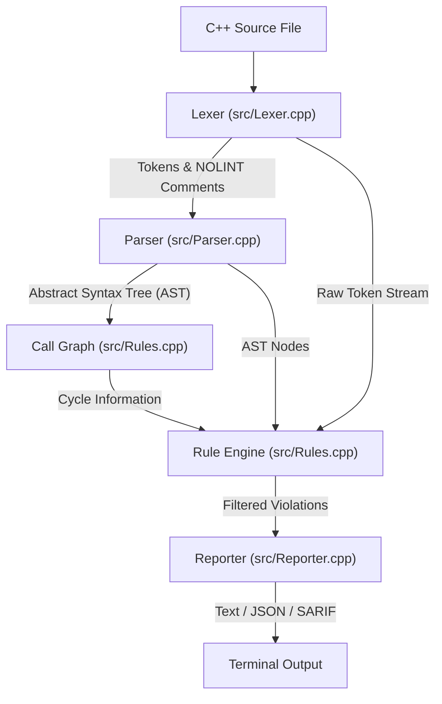

# Project Flow: How `misra_check` Works

Welcome to the project flow guide! 
This document explains how our tool takes a C++ file, checks it for danger, and gives you a clear safety report.

---

## 1. What This Project Is (In 5 Simple Lines)

1. This project is a **static analysis tool** named `misra_check`.
2. A **static analysis tool** is a computer program that reads source code without running it, searching for bugs and dangerous patterns.
3. It checks C++ code against **15 safety rules** inspired by the automotive industry standards **MISRA C++** and **AUTOSAR**.
4. It is built completely from scratch in modern **C++20** with zero third-party parsing libraries.
5. It prints findings in plain text, structured **JSON**, or industry-standard **SARIF** format.

### The Problem It Solves
When a programmer writes software for a car (like the brakes, airbag, or steering), a crash in the code can cause a physical crash on the road. 
Normal compilers (like MSVC or GCC) only check if your code follows the grammar of C++. They do NOT check if your code is dangerous. For example, a compiler will happily let you write recursive functions that might run out of memory and crash the vehicle's computer.
Our tool, `misra_check`, acts like an automated code inspector. It reads the code and warns the programmer before the code is ever installed in a vehicle.

---

## 2. The Complete Pipeline Diagram

Here is the complete path data takes inside the program, shown first with text boxes and then with a Mermaid diagram:

### Text Flow Diagram
```
+-------------------+
|  C++ Source File  |  (Example: "samples/bad_code.cpp")
+-------------------+
          |
          v
+-------------------+
|       Lexer       |  (Reads raw characters, strips whitespace, tracks // NOLINT)
+-------------------+
          |
          v  Tokens: [Keyword: "if"], [Symbol: "("], [Identifier: "x"], ...
+-------------------+
|      Parser       |  (Groups tokens into statements and functions)
+-------------------+
          |
          v  AST: TranslationUnit -> FunctionDecl -> IfStmt -> CompoundStmt
+-------------------+
|    Call Graph     |  (Builds caller-to-callee map; runs 3-Color DFS)
+-------------------+
          |
          v  Cycles detected: funcA -> funcB -> funcA
+-------------------+
|    Rule Engine    |  (Runs all 15 rules on tokens, AST, and call graph)
+-------------------+
          |
          v  Violations List (filters out // NOLINT lines, sorts by line number)
+-------------------+
|     Reporter      |  (Formats violations into Text, JSON, or SARIF)
+-------------------+
          |
          v
+-------------------+
|  Console / File   |  (Human-readable terminal output or CI/CD test report)
+-------------------+
```

### Mermaid Diagram


---

## 3. Stage-by-Stage Breakdown

Let us look at each stage one by one.

### Stage 1: The Input File
- **Which file handles it:** `src/main.cpp`
- **What goes in:** A path to a C++ file (for example, `samples/bad_code.cpp`) passed on the command line.
- **What comes out:** A single `std::string` in memory containing all the characters of the file.
- **Why it is needed:** The program must load the file from disk into computer memory before any analysis can happen.
- **Small Example:**
  ```cpp
  int main() {
      int x = 0;
  }
  ```

---

### Stage 2: The Lexer (Tokenizer)
- **Which files handle it:** `include/Lexer.h` and `src/Lexer.cpp`
- **What goes in:** The raw `std::string` of file characters.
- **What comes out:** 
  1. A `std::vector<Token>` (a list of recognized words, symbols, and numbers).
  2. A suppression map (`std::map<int, std::set<std::string>>`) recording which lines have `// NOLINT` comments.
- **What is a Token:** A **token** is the smallest meaningful unit of a programming language. Just like a sentence in English is made of words and punctuation, C++ code is made of tokens.
  - A word like `while` is a `TokenType::Keyword`.
  - A word like `myCounter` is a `TokenType::Identifier`.
  - A symbol like `(` or `+` is a `TokenType::Symbol`.
  - A number like `42` is a `TokenType::Number`.
- **Why it is needed:** Raw text is hard for computers to understand because of spaces, new lines, and tabs. The Lexer strips out unnecessary spaces and groups related characters into clean tokens.
- **Small Example:**
  - Input text: `int x = 5;`
  - Output tokens:
    - Token 1: Type = `Keyword`, Text = `"int"`, Line = 1
    - Token 2: Type = `Identifier`, Text = `"x"`, Line = 1
    - Token 3: Type = `Symbol`, Text = `"="`, Line = 1
    - Token 4: Type = `Number`, Text = `"5"`, Line = 1
    - Token 5: Type = `Symbol`, Text = `";"`, Line = 1
    - Token 6: Type = `EndOfFile`, Text = `""`, Line = 1

---

### Stage 3: The Parser (Building the AST)
- **Which files handle it:** `include/Parser.h` and `src/Parser.cpp`
- **What goes in:** The list of tokens (`std::vector<Token>`).
- **What comes out:** An **Abstract Syntax Tree (AST)** wrapped in a `std::unique_ptr<TranslationUnit>`.
- **What is an AST:** An **Abstract Syntax Tree** is a tree structure representing the grammatical structure of your code.
  - Think of a family tree or a table of contents.
  - The root of the tree is the whole file (`TranslationUnit`).
  - The branches are the functions (`FunctionDecl`).
  - Inside each function are branches for statements: `IfStmt`, `WhileStmt`, `ForStmt`, `SwitchStmt`, `VarDeclStmt`, or blocks of code `{ ... }` (`CompoundStmt`).
- **How it parses (Recursive Descent):** Our parser uses a technique called **recursive descent**. This means we have small functions named after grammar parts (like `parseIf()`, `parseWhile()`, `parseBlock()`). If `parseIf()` sees an `if` keyword, it consumes the condition and then calls `parseStmt()` to parse the inside of the if statement!
- **Why it is needed:** Tokens only tell you what words exist in order. They do NOT tell you which statements are nested inside which loops. The AST allows us to ask questions like: *"Is this statement inside an if block?"* or *"Does this switch statement contain a default label?"*
- **Small Example:**
  - Code:
    ```cpp
    void run() {
        if (x == 1) {
            y = 2;
        }
    }
    ```
  - AST Tree representation:
    ```
    TranslationUnit
      └── FunctionDecl (name: "run")
            └── CompoundStmt (function body)
                  └── IfStmt (condition: x == 1)
                        └── CompoundStmt (then branch)
                              └── Stmt (y = 2;)
    ```

---

### Stage 4: The Call Graph & Cycle Detection
- **Which files handle it:** `include/Rules.h` and `src/Rules.cpp` (class `CallGraph`)
- **What goes in:** The `TranslationUnit` AST.
- **What comes out:** A list of recursive call cycles (e.g., `funcA -> funcB -> funcA`).
- **What is a Call Graph:** A **graph** is a collection of points (called nodes) connected by arrows (called edges). In a **Call Graph**, each function is a node, and every time function `A` calls function `B`, we draw an arrow from `A` to `B`.
- **How recursion is found (3-Color DFS):**
  - **DFS** stands for **Depth-First Search**. It explores as deep as possible along each branch before backtracking.
  - We color each function with one of three colors:
    - **White (0):** Unvisited. We have not checked this function yet.
    - **Gray (1):** Currently visiting. We are inside this function exploring who it calls.
    - **Black (2):** Finished. We visited this function and all its children.
  - **The Magic Rule:** If we are exploring from function `A` and we see an arrow pointing to a function that is already **Gray**, it means we ran in a circle! We found a cycle (recursion).
- **Why it is needed:** In safety-critical embedded systems (like car brake controllers), the computer has very small, fixed memory (the stack). Recursion can blow past this limit and cause a **stack overflow**, which crashes the computer instantly.

---

### Stage 5: The Rule Engine
- **Which files handle it:** `include/Rules.h` and `src/Rules.cpp` (class `RuleEngine`)
- **What goes in:** The tokens, the AST, the Call Graph, and the suppression map.
- **What comes out:** A clean, sorted list of `Violation` objects.
- **What a Violation contains:**
  - `ruleId`: The code of the rule broken (e.g., `"NO_GOTO"`).
  - `message`: A human-friendly explanation of why it is bad.
  - `file`: The file name where it happened.
  - `line`: The exact line number in the source code.
- **Suppression Handling (`// NOLINT`):**
  - If a programmer writes `// NOLINT` or `// NOLINT(RULE_ID)` on a line, the Rule Engine catches this and ignores that violation.
- **Why it is needed:** The Rule Engine is the central coordinator. It runs all 15 rules, checks if the programmer asked to ignore any warnings, and sorts the results from top to bottom by line number.

---

### Stage 6: The Reporter
- **Which files handle it:** `include/Reporter.h` and `src/Reporter.cpp`
- **What goes in:** The vector of `Violation` objects and the chosen output format.
- **What comes out:** A formatted string printed to the terminal or saved to disk.
- **Supported Formats:**
  1. **Text:** Standard format readable by humans in a command terminal.
  2. **JSON:** Standard data format with brackets `{}` used by custom software and scripts.
  3. **SARIF:** Static Analysis Results Interchange Format (standard version 2.1.0). Used by GitHub to display security warnings directly in pull requests, and by VS Code plugins.
- **Why it is needed:** Different users need different outputs. A human wants clean text in their terminal; a build server wants SARIF or JSON to produce reports.

---

## 4. The 15 Rules Explained in Detail

Below is the complete reference for all 15 rules in our tool. Each rule has a real automotive safety motivation, a bad code example, and a good code example.

---

### 1. `NO_GOTO`
- **Rule ID:** `NO_GOTO`
- **Category:** Token Rule
- **What it flags:** Any use of the C++ `goto` keyword.
- **Why it matters in safety-critical software:** 
  The `goto` statement jumps unpredictably to another part of the function. This creates "spaghetti code" that makes it almost impossible to prove mathematical correctness or verify that variables were initialized properly.
- **Bad Code:**
  ```cpp
  void checkSensors() {
      if (sensorFailed) {
          goto emergency_stop; // VIOLATION: NO_GOTO
      }
      return;
  emergency_stop:
      stopVehicle();
  }
  ```
- **Good Code:**
  ```cpp
  void checkSensors() {
      if (sensorFailed) {
          stopVehicle();
          return;
      }
  }
  ```

---

### 2. `NO_NEW`
- **Rule ID:** `NO_NEW`
- **Category:** Token Rule
- **What it flags:** Any dynamic heap allocation using the `new` operator.
- **Why it matters in safety-critical software:**
  In a car, memory is finite. Dynamic memory allocations from the heap cause **memory fragmentation** (the memory gets broken into tiny unusable holes). Eventually, `new` can run out of memory and return a null pointer or throw an exception while driving at highway speeds.
- **Bad Code:**
  ```cpp
  void processTelemetry() {
      int* buffer = new int[100]; // VIOLATION: NO_NEW
  }
  ```
- **Good Code:**
  ```cpp
  void processTelemetry() {
      int buffer[100] = {0}; // Safe: fixed-size stack or static memory
  }
  ```

---

### 3. `NO_DELETE`
- **Rule ID:** `NO_DELETE`
- **Category:** Token Rule
- **What it flags:** Any manual deallocation using the `delete` operator.
- **Why it matters in safety-critical software:**
  Manual `delete` leads to two terrible bugs: **use-after-free** (using memory after deleting it) and **double-free** (deleting the same memory twice, corrupting heap metadata). Safety guidelines ban raw dynamic deletion completely.
- **Bad Code:**
  ```cpp
  void releaseBuffer(int* ptr) {
      delete ptr; // VIOLATION: NO_DELETE
  }
  ```
- **Good Code:**
  ```cpp
  // Use static memory pools or RAII stack objects that clean up automatically
  void releaseBuffer() {
      // No manual delete needed
  }
  ```

---

### 4. `NO_MALLOC_FAMILY`
- **Rule ID:** `NO_MALLOC_FAMILY`
- **Category:** Token Rule
- **What it flags:** Old C memory functions: `malloc`, `calloc`, `realloc`, and `free`.
- **Why it matters in safety-critical software:**
  These C functions do not call C++ constructors or destructors, they do not check types, and they return untyped `void*` pointers. Just like `new` and `delete`, they cause memory fragmentation and memory leaks.
- **Bad Code:**
  ```cpp
  void createPacket() {
      char* pkt = (char*)malloc(64); // VIOLATION: NO_MALLOC_FAMILY
      free(pkt);                     // VIOLATION: NO_MALLOC_FAMILY
  }
  ```
- **Good Code:**
  ```cpp
  void createPacket() {
      char pkt[64] = {0}; // Safe stack array
  }
  ```

---

### 5. `NO_CONTINUE`
- **Rule ID:** `NO_CONTINUE`
- **Category:** Token Rule
- **What it flags:** Any use of the `continue` statement inside loops.
- **Why it matters in safety-critical software:**
  The `continue` statement jumps straight to the next iteration of a loop. It often skips loop counter increments or cleanup code at the bottom of the loop, making loops harder to analyze and verify.
- **Bad Code:**
  ```cpp
  for (int i = 0; i < 10; ++i) {
      if (skipItem(i)) {
          continue; // VIOLATION: NO_CONTINUE
      }
      process(i);
  }
  ```
- **Good Code:**
  ```cpp
  for (int i = 0; i < 10; ++i) {
      if (!skipItem(i)) {
          process(i); // Clean if-block, no continue needed
      }
  }
  ```

---

### 6. `NO_USING_NAMESPACE`
- **Rule ID:** `NO_USING_NAMESPACE`
- **Category:** Token Rule
- **What it flags:** The directive `using namespace ...;` (especially `using namespace std;`).
- **Why it matters in safety-critical software:**
  Writing `using namespace std;` dumps hundreds of names into your file. If you have a function named `count()` and the standard library has `std::count()`, the compiler might silently call the wrong one without warning you!
- **Bad Code:**
  ```cpp
  using namespace std; // VIOLATION: NO_USING_NAMESPACE

  void compute() {
      int x = min(1, 2);
  }
  ```
- **Good Code:**
  ```cpp
  void compute() {
      int x = std::min(1, 2); // Explicit and safe
  }
  ```

---

### 7. `NO_BANNED_FUNCS`
- **Rule ID:** `NO_BANNED_FUNCS`
- **Category:** Token Rule
- **What it flags:** Ancient, unsafe C library functions: `gets`, `sprintf`, and `atoi`.
- **Why it matters in safety-critical software:**
  - `gets` has no buffer size limit and causes instant buffer overflows (it was even removed from the official C standard).
  - `sprintf` can easily overflow buffers.
  - `atoi` has undefined behavior if the number in the string is too large to fit in an integer.
- **Bad Code:**
  ```cpp
  void readInput(char* dest) {
      gets(dest); // VIOLATION: NO_BANNED_FUNCS
  }
  ```
- **Good Code:**
  ```cpp
  void readInput(char* dest, int maxLen) {
      // Use safe alternatives with size limits
      std::string safeStr;
      std::cin >> safeStr;
  }
  ```

---

### 8. `NO_ASSIGN_IN_COND`
- **Rule ID:** `NO_ASSIGN_IN_COND`
- **Category:** AST Rule
- **What it flags:** An assignment operator (`=`) inside the condition of an `if`, `while`, or `for` statement.
- **Why it matters in safety-critical software:**
  This is one of the most famous bugs in programming history: typing `if (status = 1)` when you meant to compare with `if (status == 1)`. The condition will always be true, and `status` gets overwritten by accident!
- **Bad Code:**
  ```cpp
  void checkBrakes(int pressure) {
      if (pressure = 0) { // VIOLATION: NO_ASSIGN_IN_COND (pressure becomes 0!)
          applyEmergencyBrakes();
      }
  }
  ```
- **Good Code:**
  ```cpp
  void checkBrakes(int pressure) {
      if (pressure == 0) { // Safe comparison
          applyEmergencyBrakes();
      }
  }
  ```

---

### 9. `IF_BRACES`
- **Rule ID:** `IF_BRACES`
- **Category:** AST Rule
- **What it flags:** Any `if` or `else` branch that does not use curly braces `{ }`.
- **Why it matters in safety-critical software:**
  If someone adds a second line of code to an unbraced `if` statement later, only the first line is conditionally executed. This led to famous security disasters (such as Apple's "goto fail" bug). Braces guarantee visual clarity.
- **Bad Code:**
  ```cpp
  if (speed > 100)
      warnDriver(); // VIOLATION: IF_BRACES
  ```
- **Good Code:**
  ```cpp
  if (speed > 100) {
      warnDriver(); // Safe: clearly enclosed in braces
  }
  ```

---

### 10. `LOOP_BRACES`
- **Rule ID:** `LOOP_BRACES`
- **Category:** AST Rule
- **What it flags:** Any `while` or `for` loop body that does not use curly braces `{ }`.
- **Why it matters in safety-critical software:**
  Just like `IF_BRACES`, loops without braces are dangerous traps when another programmer edits the code.
- **Bad Code:**
  ```cpp
  while (sensorReady() == false)
      sleepMs(10); // VIOLATION: LOOP_BRACES
  ```
- **Good Code:**
  ```cpp
  while (sensorReady() == false) {
      sleepMs(10); // Safe: enclosed in braces
  }
  ```

---

### 11. `SWITCH_DEFAULT`
- **Rule ID:** `SWITCH_DEFAULT`
- **Category:** AST Rule
- **What it flags:** A `switch` statement that is missing a `default:` label.
- **Why it matters in safety-critical software:**
  In hardware systems, electrical noise or bit-flips can make an enum variable hold an unexpected value. If there is no `default:` case, the program will silently do nothing, leaving the system in an unknown state.
- **Bad Code:**
  ```cpp
  switch (gearState) {
      case 1: driveForward(); break;
      case 2: reverse(); break;
      // VIOLATION: SWITCH_DEFAULT (missing default label)
  }
  ```
- **Good Code:**
  ```cpp
  switch (gearState) {
      case 1: driveForward(); break;
      case 2: reverse(); break;
      default: neutralSafeState(); break; // Safe
  }
  ```

---

### 12. `UNINIT_VAR`
- **Rule ID:** `UNINIT_VAR`
- **Category:** AST Rule
- **What it flags:** Any variable declaration without an initial value (like `int x;`).
- **Why it matters in safety-critical software:**
  In C++, local variables without initial values contain whatever random junk bytes happened to be in memory at that moment. Reading an uninitialized variable is **Undefined Behavior** and has caused real aerospace and automotive crashes.
- **Bad Code:**
  ```cpp
  void calculateThrottle() {
      int throttle; // VIOLATION: UNINIT_VAR (contains garbage bytes!)
      if (pedalPressed) throttle = 50;
      sendToEngine(throttle);
  }
  ```
- **Good Code:**
  ```cpp
  void calculateThrottle() {
      int throttle = 0; // Safe: guaranteed default value
      if (pedalPressed) throttle = 50;
      sendToEngine(throttle);
  }
  ```

---

### 13. `MAX_NESTING`
- **Rule ID:** `MAX_NESTING`
- **Category:** AST Rule
- **What it flags:** Control statements (`if`, `while`, `for`, `switch`) nested deeper than 4 levels.
- **Why it matters in safety-critical software:**
  Deeply nested code is mentally exhausting to read and virtually impossible to test thoroughly. MISRA restricts nesting to 4 levels to keep functions clean and reviewable.
- **Bad Code:**
  ```cpp
  if (a) {
      if (b) {
          if (c) {
              if (d) {
                  if (e) { // VIOLATION: MAX_NESTING (level 5!)
                      doAction();
                  }
              }
          }
      }
  }
  ```
- **Good Code:**
  ```cpp
  // Refactor using early return or separate functions
  if (!a || !b || !c || !d || !e) return;
  doAction(); // Safe: nesting level 0
  ```

---

### 14. `MAX_FUNC_LENGTH`
- **Rule ID:** `MAX_FUNC_LENGTH`
- **Category:** AST Rule
- **What it flags:** Any function definition spanning more than 50 lines of code.
- **Why it matters in safety-critical software:**
  Long functions try to do too many things. They hide side effects, mix business logic with hardware control, and cannot be unit-tested cleanly. A function should do one thing well.
- **Bad Code:**
  ```cpp
  void giantFunction() {
      // ... 55 lines of mixed code ...
      // VIOLATION: MAX_FUNC_LENGTH
  }
  ```
- **Good Code:**
  ```cpp
  // Break into smaller, testable sub-functions under 50 lines each
  void stepOne() { /* ... */ }
  void stepTwo() { /* ... */ }
  void cleanFunction() {
      stepOne();
      stepTwo();
  }
  ```

---

### 15. `NO_RECURSION`
- **Rule ID:** `NO_RECURSION`
- **Category:** Call Graph Rule
- **What it flags:** Direct recursion (a function calling itself) and indirect recursion (`A` calls `B`, and `B` calls `A`).
- **Why it matters in safety-critical software:**
  Every time a function is called, the CPU pushes a return address and variables onto the call stack. With recursion, there is no mathematical guarantee on the maximum stack depth. In an automotive ECU with only a few kilobytes of RAM, recursion will eventually cause a catastrophic stack overflow.
- **Bad Code:**
  ```cpp
  void ping() {
      pong(); // VIOLATION: NO_RECURSION
  }
  void pong() {
      ping(); // VIOLATION: NO_RECURSION
  }
  ```
- **Good Code:**
  ```cpp
  void iterate(int maxCount) {
      for (int i = 0; i < maxCount; ++i) { // Safe: iterative loop has fixed stack size
          processStep(i);
      }
  }
  ```
